# Hi, I'm Raj Salonia 👋

<picture>
  <source media="(prefers-color-scheme: dark)" srcset="assets/hero-dark.svg">
  
</picture>

**Software Engineering · Python Backend · Practical AI**

`Open to Software Engineering Internships`

[**Portfolio ↗**](https://raj-salonia-portfolio.vercel.app/) · [**LinkedIn ↗**](https://www.linkedin.com/in/rajsalonia) · [**Recruiter contact ↗**](https://www.linkedin.com/in/rajsalonia)

---

### 01 / About me

I'm a student software engineer building backend services, thoughtful APIs, and AI-assisted applications. I care about reliable, maintainable software: clear contracts, useful tests, and honest documentation.

| Now | Next |
| :--- | :--- |
| **B.Tech CSE · Class of 2028** Bhagwan Parshuram Institute of Technology, Delhi | Deepening backend design, microservices, and cloud fundamentals |
| **Software Engineering Intern** Dexpert Systems · April–July 2026 | Seeking software engineering, backend, applied AI, and cloud internships |

### 02 / Engineering toolkit

<picture>
  <source media="(prefers-color-scheme: dark)" srcset="assets/toolkit-background-dark.svg">
  
</picture>

Project experience reflects tools used in portfolio work, not a claim of expert proficiency.

| Area | Project experience |
| :--- | :--- |
| **Languages** | Python · JavaScript · TypeScript · SQL |
| **Backend** | FastAPI · REST APIs · Pydantic · SQLAlchemy · SQLite |
| **Frontend** | React · HTML · CSS · Tailwind CSS |
| **AI & data** | Agentic AI workflows · NumPy · Pandas · scikit-learn · NetworkX |
| **Delivery** | Git · Docker · GitHub Actions · testing |
| **Developing further** | Java · C++ · Nginx · AWS fundamentals · microservice architecture |

### 03 / Selected engineering work

<picture>
  <source media="(prefers-color-scheme: dark)" srcset="assets/roofshift-card.svg">
  
</picture>

#### 01 — [RoofShift AI ↗](https://github.com/rajsalonia/roofshift-ai)
Plan rooftop solar installations and allocate a constrained budget across buildings.

**FastAPI · React · TypeScript · mathematical optimization · tests · AWS deployment work**  
Geospatial analysis, solar energy forecasting, and multi-building planning. Forecasts depend on modeled assumptions.

[Source](https://github.com/rajsalonia/roofshift-ai) · [Hosted website ↗](https://d2pxwgtcwn203c.cloudfront.net/)

---

<picture>
  <source media="(prefers-color-scheme: dark)" srcset="assets/judgeforge-card.svg">
  
</picture>

#### 02 — [JudgeForge ↗](https://github.com/rajsalonia/JudgeForge)
Bring hackathon submissions and isolated judging into one self-hosted workflow.

**Python · FastAPI · SQLite · role-based permissions · statistical score normalization**  
The public instance is an evaluation demo. Do not submit sensitive participant data or confidential files.

[Source](https://github.com/rajsalonia/JudgeForge) · [Evaluation demo ↗](https://judgeforge.onrender.com/)

---

<picture>
  <source media="(prefers-color-scheme: dark)" srcset="assets/citygraph-card.svg">
  
</picture>

#### 03 — [CityGraph ↗](https://github.com/rajsalonia/citygraph)
Explore how infrastructure failures cascade through a simulated city.

**FastAPI · React · NetworkX · Leaflet · GIS visualization**  
Graph modeling and risk-aware routing with synthetic scenarios; not a live emergency-management system.

[Source](https://github.com/rajsalonia/citygraph) · [Hosted interface ↗](https://citygraph-intelligence.vercel.app/)

---

<picture>
  <source media="(prefers-color-scheme: dark)" srcset="assets/boloai-card.svg">
  
</picture>

#### 04 — [BoloAI ↗](https://github.com/rajsalonia/BoloAI)
Explore multilingual, voice-first assistance in Hindi, Hinglish, and English.

**Python · FastAPI · conversational memory · tool orchestration**  
Provider integrations are configurable; the demo can use fallback/mock adapters. Live AI, speech, telephony, and SMS providers are not independently confirmed.

[Source](https://github.com/rajsalonia/BoloAI) · [Demo ↗](https://boloai-web.onrender.com/)

Hosted links come from the project repositories. Availability and complete hosted user flows have not been independently confirmed.

### 04 / More to explore

| Project | Focus |
| :--- | :--- |
| [**ReviewLens ↗**](https://github.com/rajsalonia/ReviewLens) | Traceable evidence and conflicting review perspectives · React, TypeScript, FastAPI |
| [**Proofly ↗**](https://github.com/rajsalonia/document-forgery-ai) | Explainable document risk indicators · Python, FastAPI, React, Docker |

### 05 / Engineering journey

**Worked with**  
Python → Backend APIs → Databases → practical AI applications

**Learning & deepening**  
Microservices → Docker & CI/CD → AWS Cloud → reliable Applied AI Systems

### 06 / Building in public

My actual contribution history lives on [GitHub's contribution graph](https://github.com/rajsalonia?tab=overview) and [public repository activity](https://github.com/rajsalonia?tab=repositories).

<!-- SNAKE:START -->
<picture>
<source media="(prefers-color-scheme: dark)" srcset="https://raw.githubusercontent.com/rajsalonia/rajsalonia/output/snake-dark.svg">

</picture>
<!-- SNAKE:END -->

The animation follows GitHub contribution data. No estimated streaks, rankings, or invented activity totals.

<picture>
  <source media="(prefers-color-scheme: dark)" srcset="assets/footer-background-dark.svg">
  
</picture>

### Let's build something useful

Interested in a student engineer who enjoys backend problems and learns through implementation?

[**Connect on LinkedIn ↗**](https://www.linkedin.com/in/rajsalonia) · [**Explore my portfolio ↗**](https://raj-salonia-portfolio.vercel.app/)

Raj Salonia · New Delhi, India · Graduating in 2028
