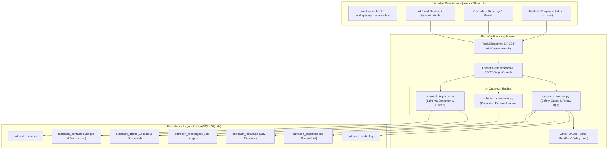

# Opportunity OS · AI-Powered Internship Tracker & Outreach Manager

[](https://github.com/rajsalonia/opportunity-os/actions)
[](LICENSE)
[](https://python.org)
[](tests/)

**Opportunity OS** is an autonomous, private command center engineered for student software engineers and graduates to discover, organize, and execute internship search workflows at scale. It pairs automated applicant tracking with an **AI Outreach Manager** capable of high-capacity recruiter spreadsheet ingestion, grounded AI email composition, strict safety rate limiting, and follow-up cadences.

---

## 🌟 Key Architecture & Capabilities

### 1. AI Outreach Manager (High-Capacity Recruiter CRM)
- **Multi-Spreadsheet Batch Ingestion**:
  - Ingests multiple spreadsheets simultaneously (`.xlsx`, `.xls`, `.csv`).
  - Capable of processing 6+ files with 500+ contacts each (3,000+ total records) in a single transactional batch.
  - Automatic column mapping heuristics with preview and manual correction support.
- **Data Quality & Syntax Validation**:
  - RFC 5322 compliant regex syntax validation.
  - Explicit detection of role-based addresses (`info@`, `sales@`, `hr@`, `careers@`) and disposable/temporary email domains.
  - Transparent data health reporting: syntax validation is explicitly documented as not guaranteeing mailbox deliverability.
- **Normalization & Smart Deduplication**:
  - Strips legal entity suffixes (`LLC`, `Inc`, `Pvt Ltd`, `Technologies`) into normalized clustering keys.
  - Multi-attribute deduplication (by normalized email, company + contact cluster, and LinkedIn URL).
  - Merges and enriches missing fields (phone, LinkedIn, title) into primary contact records while preserving original source filename attribution.
- **Grounded AI Email Composer**:
  - Zero-hallucination guarantee: emails are strictly grounded in verified applicant credentials (Raj Salonia, B.Tech CSE Class of 2028 at BPIT/GGSIPU, Dexpert Systems SDE Intern, targeting Summer 2027 internships).
  - Incorporates verified projects: **CityGraph** (transit routing algorithms), **Document Forgery AI** (deep learning image forensics), **ReviewLens** (transformer NLP), and **AstroBit** (real-time telemetry).
  - 4 company categories: `ai_ml`, `backend`, `general_software`, and `unknown`.
  - 4 writing styles: `professional`, `concise`, `technical`, and `startup_friendly`.
  - 100% editable fields: every subject line, salutation, body paragraph, and resume attachment toggle can be reviewed and edited prior to approval.

### 2. Outreach Safety Gates & Smart Cadence
- **Domain Health Daily Limits**: Strictly caps sending at **10 emails/day** across all campaigns to protect sender reputation and prevent mailbox flagging.
- **Explicit Review Gate**: Every single draft must be manually reviewed and marked `approved` with an explicit `reviewed_and_confirmed` flag before any sending call is permitted.
- **Suppression & Opt-Out List**: Checks recipient emails and domains against `outreach_suppressions`. Immediately blocks sends to unsubscribed, bounced, or opted-out contacts.
- **30-Day Duplicate Protection**: Automatically blocks outreach sends to the same contact/email within a rolling 30-day window unless it is an approved follow-up.
- **Smart Follow-Up Cadence**:
  - Caps at **1 follow-up maximum** per contact.
  - Day 7: Prepares a respectful, non-intrusive follow-up draft.
  - Day 10: Surfaces reminders in dashboard for unreplied threads.
  - Auto-Suppression: If a reply, bounce, or opt-out is detected, pending follow-ups are cancelled immediately.

### 3. Application Pipeline & Opportunity Radar
- **Discovery Sources**: Live feed parsing from employer ATS boards (Greenhouse, Lever, Ashby), public remote portals, and curated Indian fresher & internship portals (Internshala, Unstop, Naukri, Cutshort, Cuvette).
- **Stage Tracking**: Clean stage pipeline tracking (`Saved`, `Applied`, `Assessment`, `Interview`, `Offer`, `Rejected`, `Closed`).
- **Calendar & Deadlines**: Parses official application deadlines and exports standard RFC 5545 iCalendar (`.ics`) schedules in `Asia/Kolkata` time.
- **Privacy & Security First**:
  - Password authentication with exponential backoff brute-force protection.
  - CSRF origin verification on all mutation endpoints.
  - Credentials and tokens encrypted using Fernet cryptography.
  - Private applicant spreadsheets, resumes, and credentials strictly excluded from Git tracking via `.gitignore`.

---

## 🏗️ System Architecture



---

## 🚀 Quickstart & Local Development

### 1. Prerequisites
- Python 3.12+ (tested through Python 3.14)
- Node.js 20+ (for asset syntax validation)
- Git

### 2. Clone Repository
```bash
git clone https://github.com/rajsalonia/opportunity-os.git
cd opportunity-os
```

### 3. Set Up Virtual Environment & Dependencies
```bash
python -m venv .venv
# Windows:
.venv\Scripts\activate
# macOS/Linux:
source .venv/bin/activate

pip install -r requirements.txt pytest
```

### 4. Configure Environment Variables
Create a local `.env` file (strictly excluded from Git):
```bash
APP_PASSWORD=your_secure_workspace_password
SESSION_SECRET=your_random_32_character_secret
DATABASE_URL=sqlite:///opportunity_os.db
HTTPS_ONLY=false
```

### 5. Run Automated Tests
Execute the complete test suite (130 automated tests covering ingestion, deduplication, AI composition, safety limits, and REST endpoints):
```bash
python -m pytest -v
```

### 6. Start Local Development Server
```bash
python app.py
```
Open [http://localhost:5000](http://localhost:5000) in your web browser.

---

## 📊 Ingesting Recruiter Spreadsheets

To ingest multiple recruiter spreadsheets:
1. Navigate to the **AI Outreach** section (`#outreach`).
2. Click **Import Spreadsheets**.
3. Drag & drop up to 6 spreadsheets (`.xlsx`, `.xls`, `.csv`).
4. Review the auto-detected column mappings and sample data preview.
5. Click **Ingest All & Deduplicate**. The system will:
   - Normalize company names.
   - Flag role-based and suspicious email addresses.
   - Merge duplicate records while enriching new contact data.
   - Record complete source audit trails in transactional database storage.

---

## ✉️ Safe AI Email Outreach Workflow

1. **Select Candidates**: In the Candidate Directory, select one or more contacts using the checkboxes.
2. **Generate Grounded Drafts**: Choose your preferred writing style (`Professional`, `Concise`, `Technical`, `Startup-friendly`) and click **Compose with AI**.
3. **Review & Edit**: Every draft field (Subject, Body, Resume Attachment) is 100% editable. Adjust phrasing to your preference.
4. **Approve**: Click **Approve Draft**. Drafts cannot be sent without explicit approval.
5. **Send via Gmail**: Click **Send via Gmail** and confirm the safety prompt. The safety layer verifies:
   - Daily 10-email sending limit has not been reached.
   - Recipient is not on the suppression/opt-out list.
   - No outreach was sent to this recipient within the last 30 days.
   - Day 7 follow-up reminder is automatically scheduled.

---

## 🔒 Security & Privacy Practices

- **Zero Credential Leaks**: OAuth tokens, credentials, and `.env` files are never tracked in Git.
- **Suppression Protection**: Explicit opt-out and bounce lists prevent accidental spam or unwanted contact.
- **No Hallucinations**: Prompt generation adheres strictly to verified applicant data without inventing metrics, credentials, or past roles.
- **Brute Force Defense**: Login endpoints incorporate exponential lockout protection.

---

## 📄 License
Distributed under the MIT License. See [LICENSE](LICENSE) for more details.
